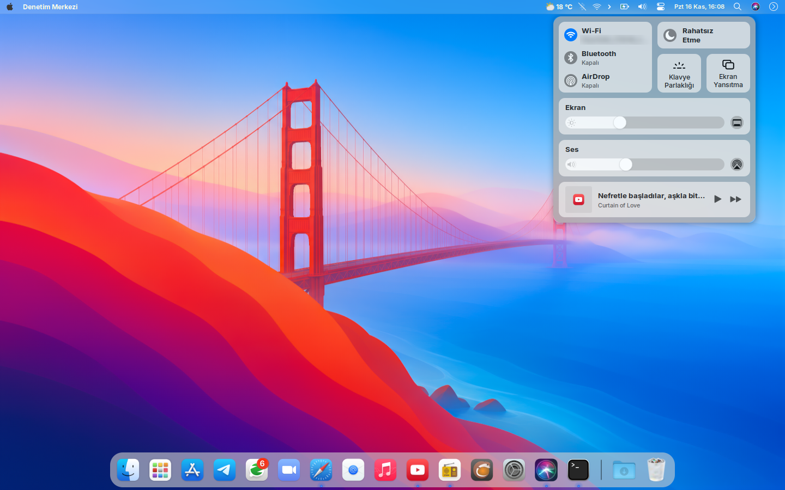
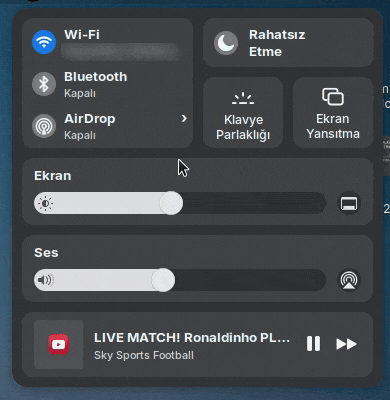
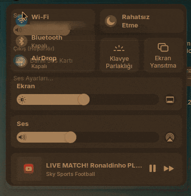
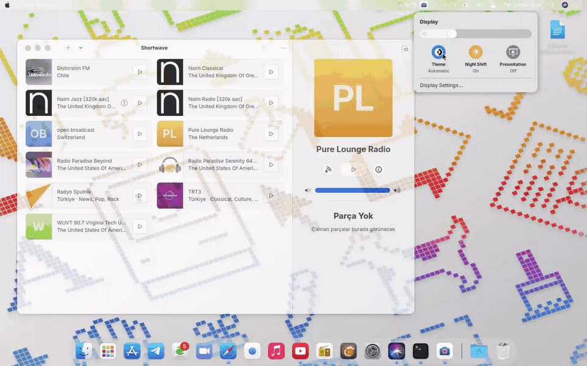
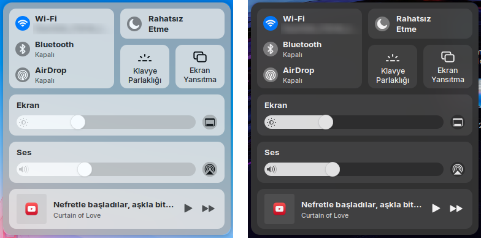
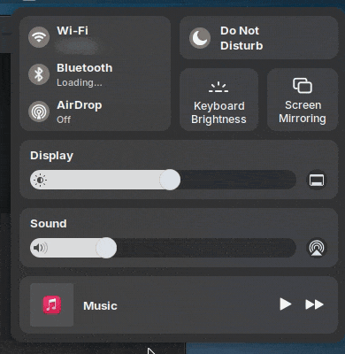
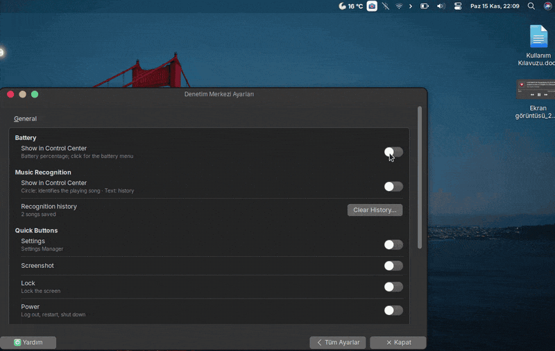
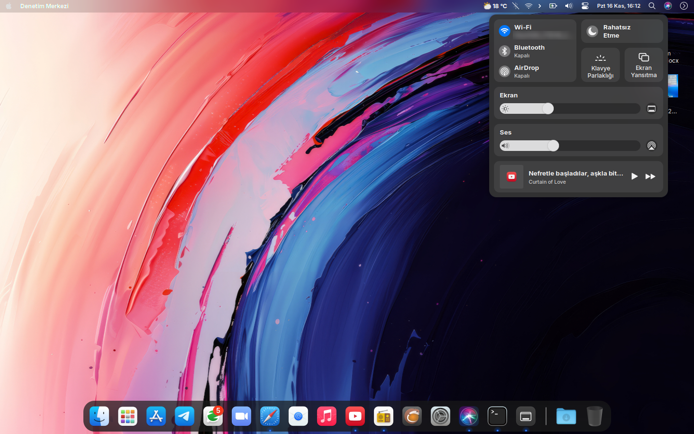
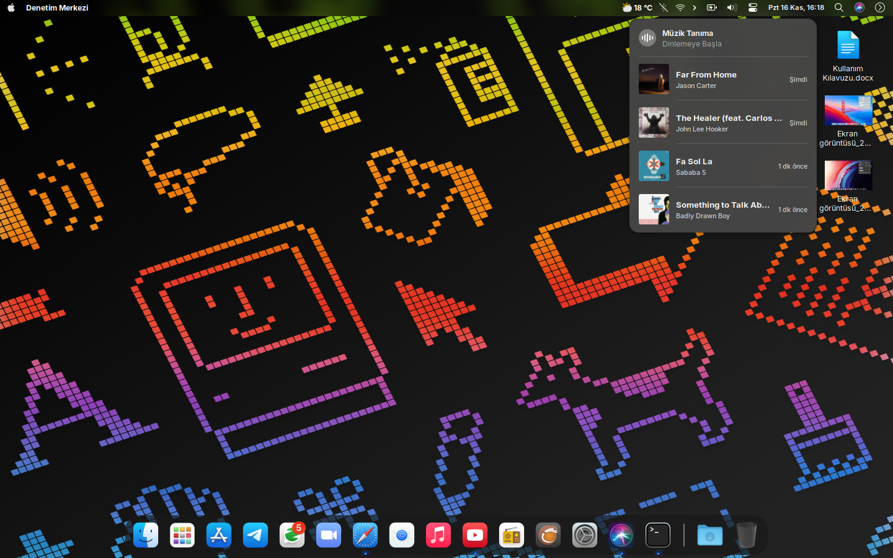

# Cupertino Control Center

A macOS Big Sur–style Control Center for the XFCE desktop, written in Python and GTK 3.

<p align="center"></p>
<p align="center"><sub>Shown with the Turkish interface; it follows the system language.</sub></p>

It started as a fork of [comice-control-center](https://github.com/libredeb/comice-control-center)
by Juan Lozano and has since been largely rewritten and extended.

## Features

- **Wi-Fi** and **Bluetooth** lists with connect/disconnect and saved hotspots
- **AirDrop**-style sharing through Valent (KDE Connect) or LocalSend
- **Do Not Disturb**, **Keyboard Brightness**, **Screen Mirroring** tiles
- **Display** brightness slider with a detail view: Dark Mode, Night Shift (gammastep),
  Presentation (xfce4-power-manager)
- **Sound** volume slider with mute and output/input device selection
- **Now Playing** media controls for any MPRIS player (artwork, progress, app badge)
- Optional bottom bar: **Battery** (with Low Power Mode), **Music Recognition**
  (SongRec), Settings, Screenshot, Lock, Power
- Follows the system light/dark color scheme
- Event-driven updates (PulseAudio, udev, UPower, MPRIS D-Bus signals) rather than polling
- English and Turkish; other languages can be added without touching the code

Tested on Xubuntu 24.04 and 26.04 (XFCE, X11) on a MacBook Air (2012) with the WhiteSur GTK
and icon themes. Other hardware should work; tiles for hardware that isn't present are hidden.

## A closer look

<p align="center"></p>

### Display

Click **Display** for Dark Mode (or your own theme script), Night Shift and Presentation.
The brightness slider is on the main view.

<p align="center"></p>
<p align="center"><sub>Shown with the Turkish interface. Screen recorders capture the picture before the backlight
and colour temperature are applied, so brightness and Night Shift are recreated in this GIF.</sub></p>

With a theme script (see [Dark Mode and theme scripts](#dark-mode-and-theme-scripts)), the first
button becomes **Theme** and steps through Automatic, Sunrise, Day, Sunset and Night. Control
Center follows the light or dark theme it sets.

<p align="center"></p>
<p align="center"></p>

### Now Playing

Click the Now Playing card to see every open player: music apps, internet radio, browser tabs.
Each card has its own controls and a badge for the app that's playing; click the progress bar
to seek.

<p align="center"></p>

### Battery, Music Recognition and quick buttons

Turn these on in the Settings window and they appear at the bottom of Control Center:

- **Battery** percentage; click it for the battery menu (Low Power Mode, apps using
  significant energy)
- **Music Recognition** identifies the song that's playing with SongRec and offers to open it
  in Shazam or search it in YouTube Music; the last result stays on the button
- **Settings**, **Screenshot**, **Lock** and **Power** buttons. If Screenshot, Lock or Power
  is on as well, Music Recognition moves to a second row.

<p align="center"></p>

### More screenshots

<p align="center"></p>

<p align="center"></p>

## Requirements

Python 3 (tested with 3.12 on Xubuntu 24.04 and 3.14 on Xubuntu 26.04; 3.10 and later should
work) with PyGObject (GTK 3), pycairo, pydbus and psutil:

```bash
sudo apt install python3-gi python3-gi-cairo gir1.2-gtk-3.0 python3-pydbus python3-psutil
```

Command-line tools, by feature:

| Feature | Needs |
| --- | --- |
| Wi-Fi | NetworkManager (`nmcli`) |
| Bluetooth | BlueZ (`bluetoothctl`) |
| Sound | PulseAudio or PipeWire-Pulse (`pactl`); `pavucontrol` for "Sound Settings…" |
| Display brightness | `brightnessctl`, `udevadm` |
| Keyboard brightness | UPower with a keyboard backlight (e.g. `smc::kbd_backlight`) |
| Now Playing | `playerctl`, `wmctrl`, `xdotool` |
| Night Shift | `gammastep` (optionally `gammastep-indicator`) |
| Presentation | `xfce4-power-manager`, `xfconf-query` |
| Screen Mirroring | `xrandr` |
| AirDrop | Valent (Flatpak) and/or LocalSend |
| Music Recognition | [SongRec](https://github.com/marin-m/SongRec) |
| Low Power Mode | `pkexec`, TLP (optional); see below |
| Bottom bar buttons | `xfce4-settings-manager`, `xfce4-screenshooter`, `xflock4`, `xfce4-session-logout` |

## Installation

Clone it anywhere; it finds its files relative to its own folder. For example:

```bash
git clone https://github.com/memecikoliveoil/cupertino-control-center.git ~/.local/share/cupertino-control-center
python3 ~/.local/share/cupertino-control-center/main.py
```

To open it from the panel, add a Launcher item that runs the command above. Clicking the
launcher again closes it, as do Esc and clicking outside the window.

Your settings and history are kept inside the folder, in
`cupertinocontrolcenter/functions/states/` (not tracked by git), so `git pull` keeps them.

### Low Power Mode helper (optional)

Switching the CPU governor needs root. A small helper accepts only two fixed commands
(`lowpower`, `normal`), and a polkit rule lets the active local user run it without a password:

```bash
sudo install -m 755 system/cupertino-cpu-policy /usr/local/libexec/cupertino-cpu-policy
sudo install -m 644 system/com.github.memecikoliveoil.cupertino-cpu-policy.policy /usr/share/polkit-1/actions/
```

## Customizing

Values meant to be adjusted (sizes, spacing, delays, thresholds) are named constants near
the top of each file or class, with a comment saying what they do. For example:

- `main.py`: window position (`WINDOW_RIGHT_OFFSET`, `WINDOW_TOP_GAP`), scrolling
  speed and direction (`SCROLL_*`)
- `functions/display_view.py`: button icon alignment (`ICON_NUDGE`)
- `functions/airdrop.py`: how Valent and LocalSend are started (`BACKEND_COMMANDS`)
- `widgets/media_box.py`: the music app opened when nothing is playing (`IDLE_APP`,
  `IDLE_COMMAND`, Lollypop by default)
- `widgets/keyboard_brightness.py`: the keyboard backlight device (`KBD_DEVICE`, detected
  automatically)
- `application.css`: colors, corner radii, fonts

### Audio device names

Give audio devices your own names (and icons) in `settings.json`:

```json
{
  "sound_device_names": [
    {"match": ["beoplay", "portal"], "name": "B&O Beoplay Portal", "type": "headphone"}
  ]
}
```

A device whose system name contains any `match` word is shown as `name`. `type` is optional
(`headphone`, `earbuds`, `speaker`, `microphone`, `display`, `internal`).

### Dark Mode and theme scripts

Dark Mode switches the GTK, window border and icon themes to their dark or light variants
(e.g. `WhiteSur-Light` ↔ `WhiteSur-Dark`, `Adwaita` ↔ `Adwaita-dark`). If your themes are
named differently, set them in `cupertinocontrolcenter/functions/states/settings.json`:

```json
{
  "light_gtk_theme": "Greybird", "dark_gtk_theme": "Greybird-dark",
  "light_wm_theme": "Greybird", "dark_wm_theme": "Greybird-dark",
  "light_icon_theme": "elementary-xfce", "dark_icon_theme": "elementary-xfce-dark"
}
```

If you have your own script that switches themes (and wallpapers) by time of day, put it at
`~/.local/bin/auto_theme.py` (or change `THEME_SCRIPT` in `functions/display_view.py`). The
button then becomes **Theme** and cycles through Automatic, Sunrise, Day, Sunset and Night;
the comment above `THEME_SCRIPT` describes what the script receives and reports.

Settings that can be changed without editing code are in the Settings window
(`python3 cupertinocontrolcenter/settings_gui.py`).

To list the Settings window in the XFCE Settings Manager, save this as
`~/.local/share/applications/cupertino-control-center-settings.desktop`, with your own path:

```ini
[Desktop Entry]
Type=Application
Name=Control Center Settings
Name[tr]=Denetim Merkezi Ayarları
Exec=python3 /path/to/cupertino-control-center/cupertinocontrolcenter/settings_gui.py
Icon=/path/to/cupertino-control-center/icons/ccc-xfce4-settings.svg
Categories=XFCE;GTK;Settings;DesktopSettings;X-XFCE-SettingsDialog;X-XFCE-PersonalSettings;
OnlyShowIn=XFCE;
X-XfcePluggable=true
```

`X-XfcePluggable=true` opens it inside the Settings Manager window, as in the GIF above.

## Translations

The interface follows the system language. To force one, set `"language"` (e.g. `"en"`,
`"tr"`) in `cupertinocontrolcenter/functions/states/settings.json`, or start with
`LANGUAGE=en`.

Translations are plain gettext `.po` files in `po/` and are read directly, with no build step.
To add a language, copy `po/cupertino-control-center.pot` to `po/<code>.po` (e.g. `po/de.po`)
and fill in the `msgstr` lines.

After adding or changing `_()` strings in the code (needs `python3-babel` and `gettext`):

```bash
make update-po
```

## Credits

- [comice-control-center](https://github.com/libredeb/comice-control-center) by Juan Lozano,
  the original project
- Icon sources are listed in [NOTICE](NOTICE)

Not affiliated with Apple Inc.

## License

GNU General Public License v3.0; see [LICENSE](LICENSE).
